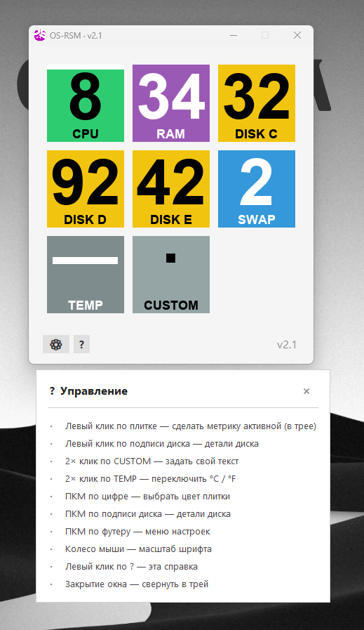
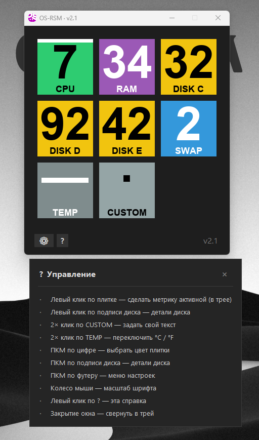
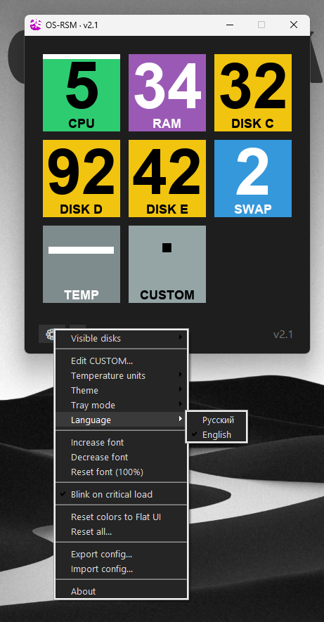

# OS-RSM — Windows

System tray monitor for Windows. Shows CPU, RAM, Disk, Swap, and Temperature live in your taskbar.

  
  
  

**Download:** [OSRSM.exe](https://github.com/alkidnn/osrsm-windows/releases) (Windows 10/11, no Python required)

## Features

- Dual-metric tray icon
- Light / dark / auto theme
- Disk details popup
- Autostart, English / Russian UI

## Credits

Based on [OS-RSM](https://github.com/MihanPROJECTS/OS-RSM) by MihanPROJECTS.
Windows version by [alkidnn](https://github.com/alkidnn).

MIT License.
